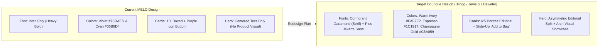
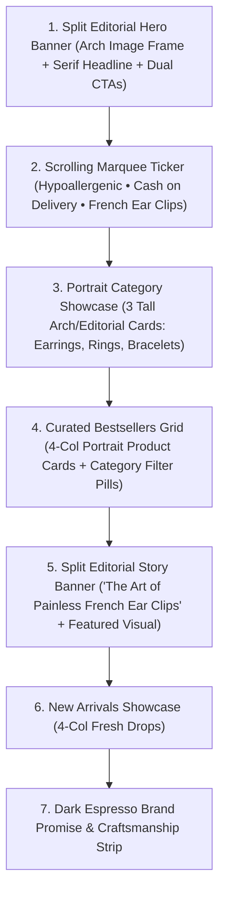

# MELO — Luxury & Editorial Jewelry Redesign Plan

**Project:** MELO Online Store (`i:/Work/business/melo`)  
**Reference Templates Studied:**

1. **Wix Studio / Marketplace Jewelry Listing** (`d8470992-0db5-4f49-9b1e-8b231abe09fc`)
2. **Blingg Jewelry Store 04** (`websitedemos.net/blingg-jewelry-store-04`)
3. **Jewelix — Webflow E-Commerce Template** (`webflow.com/templates/html/jewelix-jewelry-website-template`)
4. **Deweler — Webflow E-Commerce Template** (`webflow.com/templates/html/deweler-jewelry-website-template`)

---

## 1. Executive Study: How the 4 Reference Pages Are Made

Across all four reference templates, there is a clear architectural and visual consensus on what makes jewelry e-commerce convert and feel premium—and it contrasts sharply with standard SaaS/tech UI patterns.

### 1.1 Visual & Design System Anatomy

| Design Dimension            | Reference Templates Consensus (Wix, Blingg 04, Jewelix, Deweler)                                                                                                                                                                                                                          | Current MELO Implementation ([`globals.css`](../src/app/globals.css))                                                                                                                            |
| :-------------------------- | :---------------------------------------------------------------------------------------------------------------------------------------------------------------------------------------------------------------------------------------------------------------------------------------- | :----------------------------------------------------------------------------------------------------------------------------------------------------------------------------------------------- |
| **Typography Pairing**      | **High-contrast editorial Serif** (`Cormorant Garamond`, `Playfair Display`, or `Cinzel`) for `H1`–`H3` headings paired with a clean **geometric Sans-Serif** (`Plus Jakarta Sans`, `Inter`, or `Jost`) for body, price tags, and UI controls.                                            | Single font (`Inter`) used everywhere with heavy `font-black` / `font-extrabold` weights, giving a SaaS/tech dashboard feel rather than a boutique jewelry vibe.                                 |
| **Color Palette**           | **Warm Alabaster, Ivory, Champagne & Espresso/Onyx:** Soft cream/ivory canvas (`#FAF7F2` / `#F6F1EB`), deep charcoal/espresso ink (`#1C1917`), muted stone (`#78716C`), and **Champagne Gold / Antique Brass** (`#C5A059` / `#B08D57`) accents.                                           | **SaaS Violet & Cyan Aurora:** `#7c3aed` (Violet), `#06b6d4` (Cyan), `#f43f5e` (Rose) with purple shadows (`shadow-violet-500/25`). Competes visually with gold and pearl product photos.        |
| **Border Radius & Framing** | **Architectural Geometry:** Sharp or subtly softened corners (`0px` to `4px` on cards/buttons) combined with **editorial arch masks (`rounded-t-full`)** or thin hairline borders (`1px solid #E7E0D6`).                                                                                  | Heavy rounded pills (`rounded-2xl`, `rounded-3xl`, `rounded-full` everywhere) with thick glassmorphism blurs.                                                                                    |
| **Product Card Anatomy**    | **Frameless / Minimal Editorial Cards:** Vertical `4:5` portrait aspect ratio, ultra-clean image container, subtle zoom or secondary angle on hover, slide-up "Add to Bag" bar at the bottom of the image, centered or left-aligned title in refined weight, and understated price below. | `1:1` square aspect ratio inside a boxed card (`rounded-2xl glass-card`), loud colored pills (`bg-violet-600`, `bg-amber-500`), and a purple square cart icon button in the bottom-right corner. |
| **Header & Navigation**     | **3-Zone Boutique Header:** Top announcement bar in deep espresso/onyx; main bar with left navigation links, **centered editorial wordmark**, and right utility icons (search, language, minimal bag counter).                                                                            | Left logo with a gradient purple square icon (`M`), pill-shaped active nav links (`bg-violet-100`), and a solid purple pill cart button.                                                         |

---

### 1.2 Breakdown of Each Reference Template

#### A. Wix Studio Jewelry Boutique Template (`d8470992-0db5-4f49-9b1e-8b231abe09fc`)

- **Layout Technique:** Uses asymmetrical split-screen hero sections (60% lifestyle/editorial visual, 40% typographic storytelling), overlapping image frames, and smooth scroll-triggered parallax reveals.
- **Key Signature:** Arch-shaped image masks (`border-top-left-radius: 9999px; border-top-right-radius: 9999px`), sticky storytelling blocks where one column pins while the right column scrolls through curated pieces, and an infinite horizontal marquee ticker for brand promises.

#### B. Blingg Jewelry Store 04 (`websitedemos.net/blingg-jewelry-store-04`)

- **Layout Technique:** Built around generous whitespace, ultra-thin hairline dividers (`1px solid #EAE5DF`), and a classic centered luxury hierarchy.
- **Key Signature:**
  - **Hero:** Full-height or split editorial banner with an italic serif pre-heading, oversized serif headline, and an outlined/solid dark rectangular CTA button with wide letter-spacing (`tracking-[0.2em] uppercase`).
  - **Category Showcase:** Tall portrait cards (`aspect-[3/4]`) where the category title sits over a subtle bottom gradient or cleanly underneath with an item count.
  - **Trust Bar:** Minimalist single-line icon + serif/sans-serif grid without heavy colored icon boxes.

#### C. Jewelix (`webflow.com/templates/html/jewelix-jewelry-website-template`)

- **Layout Technique:** Modular Webflow CMS grid system with strong editorial rhythm—alternating between 4-column product grids and full-bleed 2-column "Craftsmanship / French Light Luxury Story" banners.
- **Key Signature:**
  - **Product Cards:** Clean white/cream background, upper-left minimal text badge (`NEW` in tracked-out uppercase on ivory/gold), and a full-width hover action bar that slides up over the bottom of the image.
  - **Promotional Split Banner:** Pairs a close-up jewelry photo with a narrative block ("Hypoallergenic Comfort — Designed for Everyday Elegance") and a secondary CTA.

#### D. Deweler (`webflow.com/templates/html/deweler-jewelry-website-template`)

- **Layout Technique:** High-contrast luxury layout that alternates warm ivory sections (`#FAF7F2`) with rich espresso/onyx sections (`#181512`) to create visual drama and pacing.
- **Key Signature:**
  - **Tabbed Collection Switcher on Homepage:** Allows instant switching between _Featured_, _New Arrivals_, and _Ear Clips_ or _Rings_ without leaving the home screen.
  - **Editorial Lookbook / Social Proof Strip:** Curated gallery strip and refined customer guarantee badges before a dark luxury footer.

---

## 2. Gap Analysis: Current MELO vs. Target Design

1. **The Hero Section Lacks Product Photography ([`home.feature.tsx`](../src/features/home/home.feature.tsx#L25-L62)):**
   Currently, the hero section is just centered text over two blurred purple/cyan circles. Jewelry buyers buy with their eyes first—every reference template leads with striking product imagery in the hero fold.
2. **Purple & Cyan Clash with Gold & Pearl Jewelry ([`globals.css`](../src/app/globals.css#L6-L20)):**
   All 54 products in [`products.data.ts`](../src/core/data/products.data.ts) feature warm gold, silver, and pearl tones. Bright violet buttons and badges visually overpower the delicate jewelry photos.
3. **Boxy 16:9 Category Cards ([`home.feature.tsx`](../src/features/home/home.feature.tsx#L75-L110)):**
   Categories currently use `aspect-video` (`16:9`), which crops vertical earrings and rings awkwardly. Switching to `aspect-[4/5]` or `aspect-[3/4]` portrait cards (or arch-top frames) immediately showcases jewelry properly.

---

## 3. Step-by-Step Redesign Plan (3-Tier Architecture Compliant)

All changes strictly preserve MELO's 3-tier architecture (`src/core/`, `src/shared/`, `src/features/`, `src/app/`), TypeScript strictness, and existing cart/order/i18n logic.

### Phase 1: Global Design System & Typography Foundation

**Files to Modify:**

- [`src/app/layout.tsx`](../src/app/layout.tsx)
- [`src/app/globals.css`](../src/app/globals.css)

**Planned Changes:**

1. **Load Editorial Google Fonts in [`src/app/layout.tsx`](../src/app/layout.tsx):**
   - Import `Cormorant_Garamond` (weights `400`, `500`, `600`, `700`, normal & italic) for display/headings (`--font-serif`).
   - Import `Plus_Jakarta_Sans` (or keep `Inter` alongside `Cormorant_Garamond`) for crisp UI, body copy, and BDT currency formatting (`--font-sans`).
2. **Update Design Tokens in [`src/app/globals.css`](../src/app/globals.css):**
   - `--bg-base`: `#FAF7F2` (Warm Alabaster / Ivory)
   - `--bg-surface`: `#FFFFFF` (Pure White)
   - `--bg-muted`: `#F3EDE4` (Soft Sand / Champagne Tint)
   - `--bg-dark`: `#181512` (Deep Espresso / Onyx for dark contrast sections)
   - `--text-main`: `#1C1917` (Rich Charcoal)
   - `--text-muted`: `#78716C` (Warm Stone)
   - `--color-primary`: `#1C1917` (Boutique Obsidian for primary CTAs)
   - `--color-gold`: `#C5A059` (Champagne Gold for accents, badges, active borders)
   - `--color-gold-light`: `#E6D5B8` (Soft Gold hairline border)
   - `--border-subtle`: `#E7E0D6` (Warm Hairline Border)
3. **Add Utility Classes in [`src/app/globals.css`](../src/app/globals.css):**
   - `.font-serif-display`: Applies `var(--font-serif)` with refined tracking.
   - `.arch-frame`: Applies `border-radius: 9999px 9999px 12px 12px` for Wix/Blingg-inspired arched editorial imagery.
   - `.boutique-btn-primary` & `.boutique-btn-outline`: Uppercase, wide-tracked (`tracking-[0.18em]`), refined rectangular/slightly-rounded (`rounded-none` or `rounded-sm`) luxury buttons with smooth gold/espresso hover transitions.
   - Keep `.reveal` and `.delay-1`..`.delay-6` scroll animations intact.

---

### Phase 2: Shared Components Transformation (`src/shared/`)

#### 2.1 Boutique Navbar ([`src/shared/navbar/navbar.component.tsx`](../src/shared/navbar/navbar.component.tsx))

- **Top Announcement Bar:** Transition from the loud purple-cyan gradient to a sleek **Deep Espresso (`#181512`)** bar with Champagne Gold (`#D4AF37`) sparkle icon and tracked-out uppercase announcement text (`CASH ON DELIVERY ACROSS BANGLADESH • FREE SHIPPING OVER ৳1,500`).
- **Main Header Layout (Blingg 04 / Jewelix style):**
  - **Left (Desktop):** Clean uppercase navigation links (`HOME`, `SHOP ALL`, `EARRINGS`, `RINGS`, `BRACELETS`) with an animated 1px gold/charcoal underline on hover/active instead of purple pill backgrounds.
  - **Center (or Left-aligned with Editorial Spacing):** `MELO` rendered in large tracked-out `Cormorant Garamond` serif (`tracking-[0.28em] font-semibold text-2xl sm:text-3xl`) with a subtle `DHAKA • EST. 2026` sub-label.
  - **Right:** Minimalist expandable/inline search input with bottom hairline border, clean `EN / বাংলা` toggle, subtle Admin link, and a refined shopping bag trigger with a champagne-gold or espresso badge counter.

#### 2.2 Editorial Product Card ([`src/shared/product-card/product-card.component.tsx`](../src/shared/product-card/product-card.component.tsx))

- **Portrait Aspect Ratio:** Change image container from `aspect-square` to `aspect-[4/5]` (`bg-[#F3EDE4]/50`) so earrings and rings have vertical breathing room.
- **Refined Badges:** Replace bright purple/orange pills with crisp, minimal boutique tags (`top-3 left-3`):
  - `NEW`: Warm ivory background (`bg-[#FAF7F2]/95`) with `text-[#1C1917]` and `tracking-[0.15em] text-[10px] uppercase font-semibold border border-[#E6D5B8]`.
  - `EAR CLIP`: Subtle champagne gold tint (`bg-[#C5A059]/90 text-white text-[10px] tracking-widest uppercase`).
- **Slide-Up Hover Action Bar (Jewelix / Deweler pattern):**
  - On desktop hover, a sleek translucent bar slides up at the bottom of the image with **"ADD TO BAG"** + **"VIEW"**, while on mobile a clean, accessible `+ Add` button remains visible so touch users can add in one tap.
- **Typography & Price:**
  - Category label in muted warm stone (`text-[10px] uppercase tracking-[0.18em] text-[#8C7A5B]`).
  - Product title in `font-serif text-base sm:text-lg font-medium text-[#1C1917] group-hover:text-[#9A7B3E]`.
  - Price in crisp sans-serif (`text-sm font-semibold text-[#1C1917]`) with strikethrough original price in `#A8A29E`.

#### 2.3 Slide-Out Cart Drawer ([`src/shared/cart-drawer/cart-drawer.component.tsx`](../src/shared/cart-drawer/cart-drawer.component.tsx))

- Restyle header with serif title (`Your Shopping Bag`), warm alabaster summary footer (`bg-[#FAF7F2]`), champagne-gold active border on the Inside/Outside Dhaka selector, and a full-width dark espresso primary checkout button (`PROCEED TO CHECKOUT`).

#### 2.4 Luxury Editorial Footer ([`src/shared/footer/footer.component.tsx`](../src/shared/footer/footer.component.tsx))

- **Contrast Dark Section (Deweler / Jewelix style):** Transition the footer to a rich dark espresso (`bg-[#181512] text-[#FAF7F2]`) or warm sand-ivory layout with hairline dividers (`border-[#2E2925]`).
- **Top Service Guarantees Strip:** 4-column editorial service bar (Nationwide Delivery, Cash on Delivery, Painless Silicone Ear Clips, Direct Concierge Support) with thin vertical dividers and gold line icons.
- **Newsletter / First-Order Incentive Banner:** Add an editorial sign-up / WhatsApp community strip above the footer columns.

---

### Phase 3: Homepage Redesign (`src/features/home/home.feature.tsx`)

**Planned Changes in [`src/features/home/home.feature.tsx`](../src/features/home/home.feature.tsx):**

1. **Asymmetric Split Hero Section (Wix + Blingg 04 + Deweler fusion):**
   - **Left Column:** Uppercase gold eyebrow (`CURATED FRENCH LIGHT LUXURY`), large `Cormorant Garamond` headline (_"Where Little Wonders Light Up."_ with italic serif emphasis), refined subheading, primary dark CTA (`EXPLORE COLLECTION`), secondary outline CTA (`FRENCH EAR CLIPS`), and quick trust metrics (`50+ Curated Pieces` • `100% Painless Clips` • `Nationwide COD`).
   - **Right Column:** A multi-layered editorial composition featuring a tall **arch-masked (`arch-frame`) hero showcase image** (`/products/earrings/Wreath%20Flowers.webp` or `/products/earrings/Flowers.webp`) paired with a floating secondary miniature card (`/products/rings/J008%20gold.webp`) and a subtle rotating/floating gold seal badge.
2. **Subtle Editorial Ticker Bar:**
   - A slim warm-sand strip separating the hero from categories: `✦ PAINLESS SILICONE EAR CLIPS  ✦ TARNISH-RESISTANT 316L STEEL RINGS  ✦ CASH ON DELIVERY ACROSS BANGLADESH  ✦ INSPECT BEFORE YOU PAY`.
3. **Shop by Category — Tall Editorial Portrait Grid:**
   - 3-column layout where each category (`Earrings`, `Rings`, `Bracelets`) uses a tall `aspect-[4/5]` portrait frame with subtle inner border, dark bottom vignette, serif category title, item count badge, and `Explore Collection →` link.
4. **Featured Collection with Quick-Filter Tabs (Deweler pattern):**
   - Allow visitors to filter the homepage featured grid (`All Featured`, `Earrings`, `Rings`, `Bracelets`) or jump straight to `/shop`.
5. **Editorial Split Banner ("The MELO Ear Clip Experience"):**
   - Inspired by Jewelix's mid-page storytelling block: 2-column split with close-up photography of the transparent silicone cushion ear clips on one side, and narrative copy explaining why MELO's French ear clips never pinch or require pierced ears on the other.
6. **New Arrivals & Dark Luxury Promise Section:**
   - Replace the purple/indigo gradient box at the bottom of [`home.feature.tsx`](../src/features/home/home.feature.tsx#L176-L204) with a rich **Espresso & Champagne Gold (`bg-[#181512]`)** editorial banner with 3 architectural value pillars.

---

### Phase 4: Inner Pages Refinement (`src/features/`)

1. **Shop / Catalog Page ([`src/features/catalog/catalog.feature.tsx`](../src/features/catalog/catalog.feature.tsx)):**
   - Add a minimal editorial page header banner (`bg-[#F3EDE4]/60`) with breadcrumb (`Home / Collection`), serif title (`The Jewellery Collection`), and item count.
   - Restyle category filter tabs from purple pills to boutique editorial tabs (`bg-[#1C1917] text-white` when active, `bg-white border border-[#E7E0D6] text-[#78716C]` when inactive).
2. **Product Detail Page ([`src/features/product-detail/product-detail.feature.tsx`](../src/features/product-detail/product-detail.feature.tsx)):**
   - Upgrade product presentation to a 2-column luxury layout with `aspect-[4/5]` framed imagery, breadcrumb navigation, serif product title (`text-3xl sm:text-4xl`), gold/espresso stock & category badges, refined quantity stepper, full-width dark `ADD TO BAG` and gold-accented `BUY IT NOW` buttons, plus structured accordion/info blocks for _Material & Care_, _Silicone Clip Comfort_, and _Bangladesh Delivery Rates_.
   - Add a **"You May Also Like"** 4-column related products section at the bottom using `productService.getProductsByCategory(product.category)`.
3. **Checkout Page ([`src/features/checkout/checkout.feature.tsx`](../src/features/checkout/checkout.feature.tsx)):**
   - Replace violet focus rings and buttons with warm stone borders, champagne-gold active delivery zone cards, and a high-trust dark espresso `COMPLETE ORDER` button.

---

## 4. Verification & Quality Assurance Plan

Per [`docs/CLAUDE_INSTRUCTIONS.md`](./CLAUDE_INSTRUCTIONS.md):

1. **3-Tier Architecture Check:** Verify all UI components remain strictly in `src/shared/` and `src/features/`, with no business logic leakage.
2. **TypeScript & Linter Check:** Run `npm run lint` to confirm **0 errors and 0 warnings**.
3. **Targeted Test Execution:** Run only affected unit test files if any utility/service is touched (no data or service logic breaks are required for this visual redesign).
4. **No Git Commits:** Leave all changes uncommitted in the working tree for owner review.
